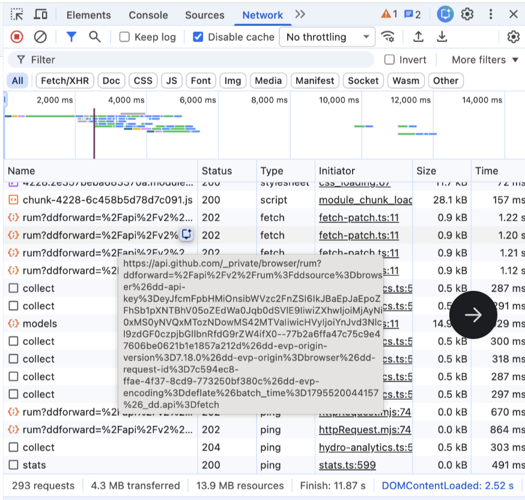
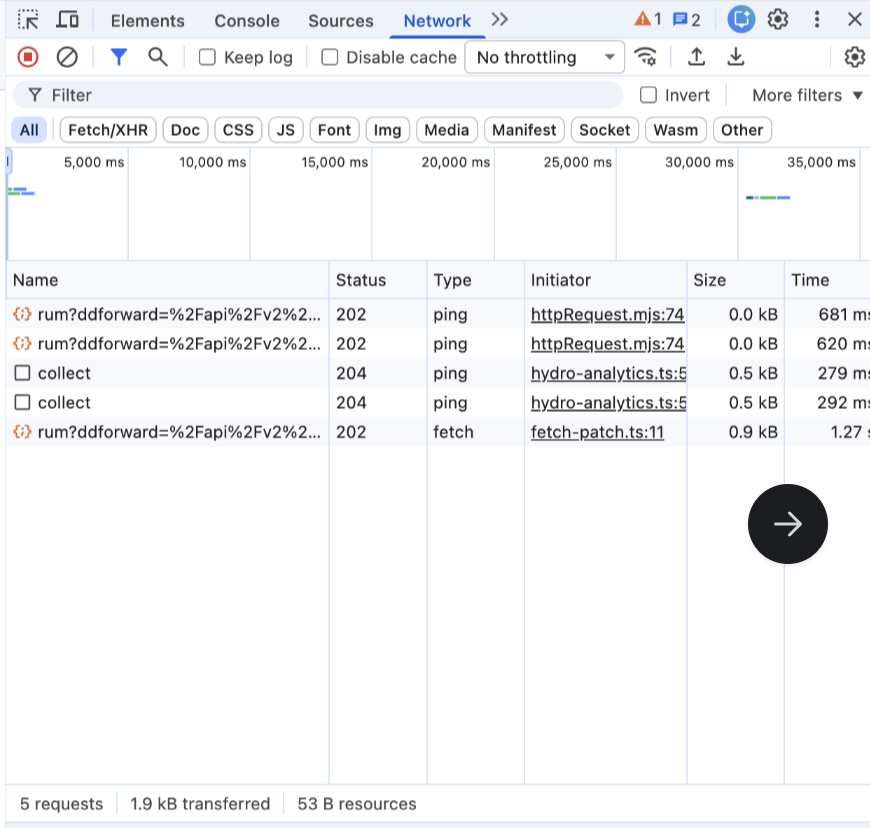
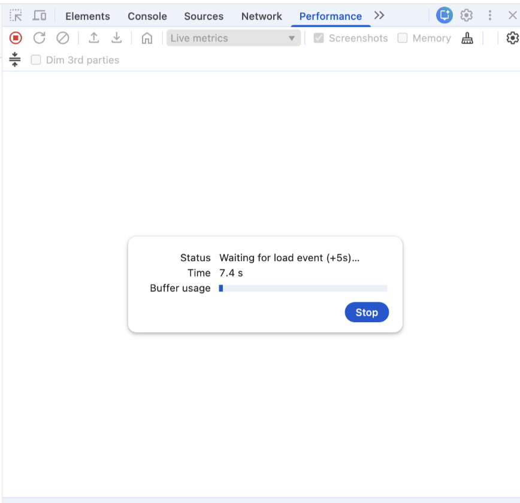

# Week 1, Day 1 (23 Nov): What happens when I open our app's URL

## Assignment

Open the project's web app login page with DevTools: read the Network waterfall, find a render-blocking file, record a Performance trace, inspect cookies and storage. Write one page: "what happens when I open our app's URL". Then open View Page Source on the app and compare it with the Elements panel: is the HTML built on the server or in the browser?

## What happens when I open our app's URL

When you open our app's URL, the browser resolves the hostname through DNS, opens a TCP connection (SYN, SYN-ACK, ACK) and, for HTTPS, negotiates TLS (1 round trip on TLS 1.3, 2 on 1.2). It then sends an HTTP GET, and the first byte of the response is the TTFB. Assuming a React single-page app, what comes back is a small index.html with an empty `
`.

The parser builds the DOM from it, while the preload scanner starts fetching the CSS and JS early. The CSS builds the CSSOM and blocks rendering, and a script without async or defer blocks the parser (and waits for the CSSOM), so the user sees a blank page. Once the bundle runs, React builds the real DOM on the main thread and calls our Rails API, which is cross-origin if it lives on a different host or port.

The same-origin policy blocks the page from reading that response unless the server allows it via CORS, and any cookies are sent only if their Domain, Path, Secure and SameSite rules match. DOM and CSSOM combine into the render tree (visible nodes with computed styles), which goes through layout, paint, raster and composite. The compositor thread and GPU put the frame on screen. The page is interactive once the main thread is free enough to respond to input quickly.

## Evidence

### Network panel: page load

Cache disabled, 293 requests, 4.3 MB transferred (13.9 MB of resources), `DOMContentLoaded` at 2.52 s, load finished at 11.87 s.

### Network panel: background requests

After the page settles, only 5 requests remain (1.9 kB): `rum` and `collect` pings plus one `fetch`, initiated by `httpRequest.mjs`, `hydro-analytics.ts` and `fetch-patch.ts`.

### Performance panel: recording

A page-load recording in progress ("Waiting for load event", 7.4 s elapsed).

